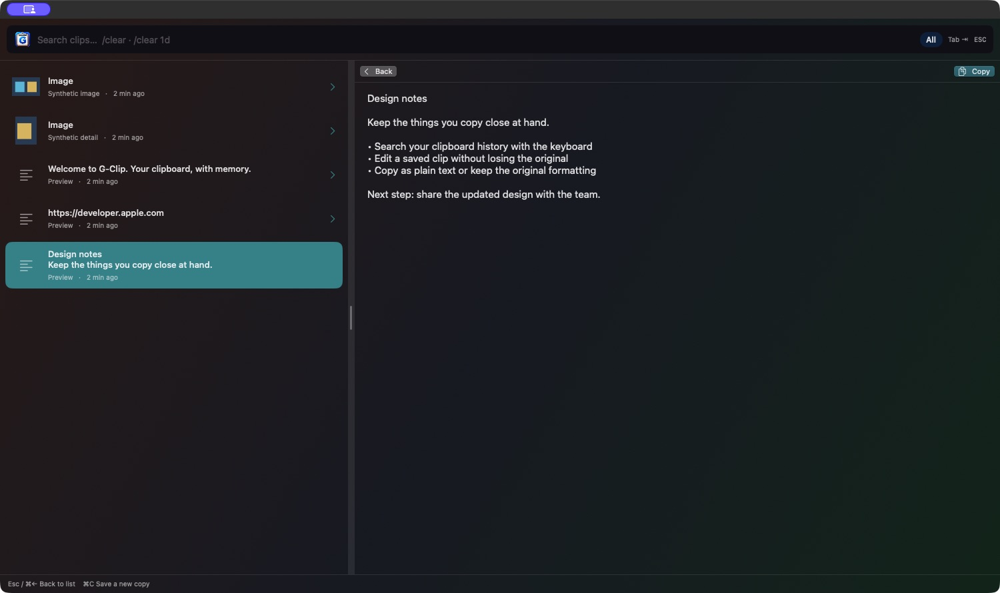
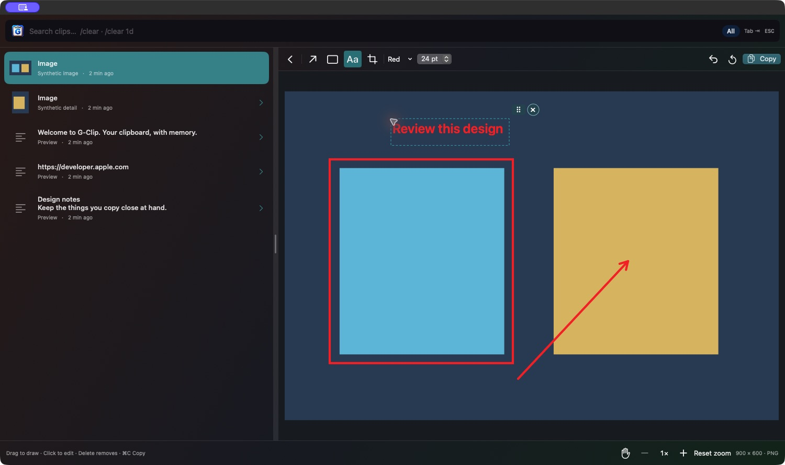

# G-Clip

A native, keyboard-friendly macOS clipboard manager for personal use. **Apple Silicon (M1 or newer), macOS 13+.** Current version: **0.3.9**.

## Screenshots

### Text editing

Edit a saved text clip and save it as a new entry while preserving the original.



### Image editing

Add arrows, rectangles, and text annotations, with zoom and pan controls.



Screenshots use synthetic sample content from 0.3.8; the editor’s Copy button is now Save (⌘S).

## Install

1. Download `G-Clip-0.3.9-arm64.zip` from [Releases](https://github.com/costa37/g-clipboard-manager/releases).
2. Unzip it and drag **G-Clip.app** into **Applications**. Quit any older G-Clip before replacing it.
3. Open the app. This personal build is ad-hoc signed and is **not Apple-notarized**. If macOS blocks it, review the message in System Settings → Privacy & Security and use **Open Anyway** only if you trust this download. Managed Macs may prohibit it.
4. For automatic pasting, grant G-Clip access in System Settings → Privacy & Security → Accessibility. New ad-hoc builds may require granting this again.

Updates are manual: download the next release and replace the app. No Sparkle updater is included. History remains in your user Library when the app is replaced. Each Mac has independent history.

## Use

- **Option + Command + Space:** open history.
- **Up/Down**, then **Return:** select and paste plain text. **Shift + Command + V:** paste saved formatting while G-Clip is open.
- **Tab / Shift+Tab:** cycle All, Text, and Images while browsing.
- **Right arrow:** edit a clip. **Command + S** or **Save** saves a new entry and keeps the original. The saved item is also placed on the clipboard. **Command + C** copies selected text normally.
- Images support crop, movable arrows, rectangles, text annotations, zoom, and pan.
- **Escape:** leave editing or close the panel. Click outside to dismiss.
- Drag the app icon in the search box to move the window; drag the divider to resize the panes.
- Right-click the menu-bar icon for themes, font size, launch at login, permissions, and Quit.
- `/clear` clears history; `/clear 1d` clears entries copied/reused in the last 24 hours, after confirmation. Clearing also empties the system clipboard.

## Privacy and limitations

Clipboard history stays locally at `~/Library/Application Support/G-Clip/history.json`. There is no telemetry, cloud sync, or network service. History is not encrypted by the app. Retention is 30 days / 1,000 entries, with 10 MB per clip and 100 MB total payload limits. Sensitive-clipboard filtering is best effort; pause capture before copying secrets.

This is a personal-use beta. Intel Macs are unsupported. Gemini Mini Chat automatic paste still needs end-to-end validation. Manual installation and Accessibility checks on a second Mac remain necessary. Image edits export a flattened PNG; annotation layers are not saved after saving/reopening.

## Build from source

Install Xcode Command Line Tools, then run:

```sh
bash scripts/build.sh
CONFIGURATION=debug bash scripts/build.sh
.build/debug/GClip --self-test
bash scripts/build.sh
bash scripts/package.sh
```

The release build is at `dist/G-Clip.app`; the installable ZIP and checksum are in `dist/`. For a debug build, use `CONFIGURATION=debug bash scripts/build.sh`. No developer account or external dependencies are required.

See [release instructions](RELEASE.md) and [changelog](CHANGELOG.md). Licensed under [MIT](LICENSE).
